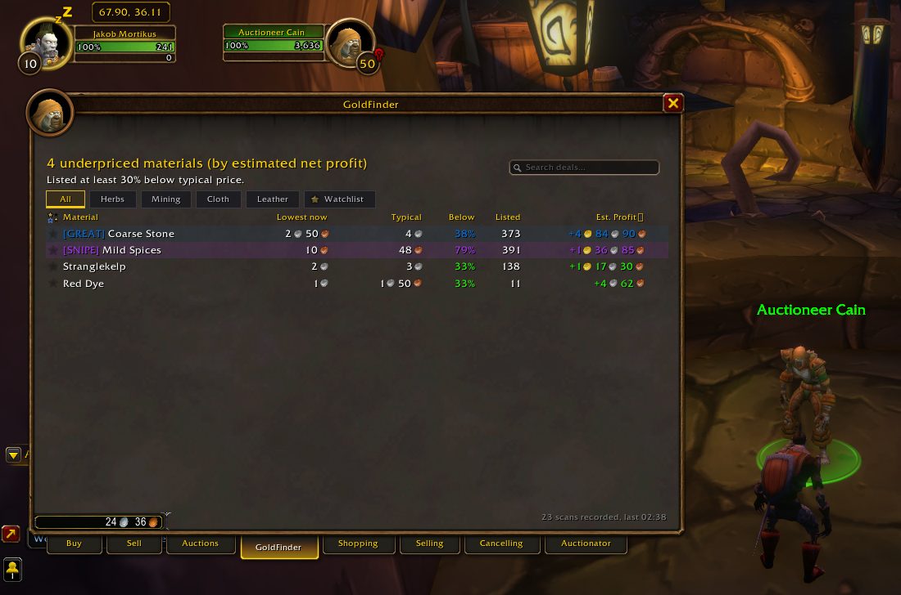

# wow-addons

World of Warcraft addon monorepo centered on **WoW: Forever** (1.60.1, Interface `16001`) alongside multi-client Classic/Retail support — featuring AH gold-making tools, BiS gear lookup, client API probing, and an AI developer Copilot package (`mcp/` + `reference/`).

## Layout

This is a monorepo: one folder per addon under `addons/`, each self-contained and independently installable.

```
wow-addons/
  addons/
    <AddonName>/
      <AddonName>.toc        # and/or <AddonName>_<Client>.toc for multi-client addons
      *.lua
      Knowledge/              # curated, sourced data only — see AGENTS.md
      tests/                  # optional, per-addon Busted specs
  .claude/skills/             # repo-local AI agent skills (wow-addon-partner)
  docs/                       # build measurements, release & Copilot DevKit guides, CurseForge pages
  mcp/                        # wow-api MCP server (verified build signatures, enums & events)
  reference/                  # dumped API JSON/Markdown reference from ForeverProbe
  scripts/
    link-addons.ps1           # symlinks addons/* into your local WoW install(s)
    run-tests.ps1             # Luacheck + Busted test runner (also run-tests.sh)
    check-toc.js              # validates .toc Interface headers, LoadOnDemand & file paths
    check-lua.js              # Lua 5.1 syntax verification across addons/
    package-addon.ps1         # builds clean release zip using .pkgmeta
    package-devkit.ps1        # builds standalone WoW: Forever Addon Copilot DevKit zip
  .github/workflows/
    validate.yml              # syntax, .toc & test checks on push/PR
    release.yml               # tagged addon zip & CurseForge release automation
  AGENTS.md                   # working rules for AI agents and contributors
```

## Local dev setup

1. Clone the repo (`git clone https://github.com/justadakaje/wow-addons.git`).
2. Run `scripts/link-addons.ps1 -WowPath "<path to your Interface\AddOns folder>"` to symlink every addon in `addons/` into your live WoW install. Symlinks let you edit in the repo and reload in-game with no copy step.
3. Verify edits before committing:
   - `node scripts/check-toc.js addons` and `node scripts/check-lua.js addons`
   - `powershell -ExecutionPolicy Bypass -File scripts/run-tests.ps1` (runs `luacheck` + `busted`)
4. **WoW: Forever Addon Copilot (`wow-api` MCP):** Build and attach the local MCP server in `mcp/` so AI coding assistants verify `C_*` APIs, events, and enums against live build `70862` captures instead of guessing. See [docs/copilot-devkit.md](docs/copilot-devkit.md) for standalone setup, or run `scripts/package-devkit.ps1` to bundle a portable zip for fellow addon developers.

## Addons

| Addon | Client(s) | Status | Link |
| --- | --- | --- | --- |
| **GoldFinder** | Multi-Client (Forever `16001`, Retail, Classic Era, MoP) | `v2.0.0` — AH deal & snipe scanner, crafting arbitrage, Disenchant EV, Bark/Cross-Market, Goblin Ledger P&L, 30-day charts, Multi-Alt Hub, TradeSkill overlay (CurseForge ID `1715781`) | [README](addons/GoldFinder/README.md) |
| **BiSGearFinder** | Forever (`16001`) | `v0.1.0` — Class/spec Best-in-Slot browser (`/bgf`, `/bis`) with dungeon/raid/craft filters and optional `GoldFinder` `[ BiS BoEs ]` bridge | [README](addons/BiSGearFinder/README.md) |
| **MeridianScout** | Forever (`16001`) | Read-only character state, active/completed quests, bind, and observed flight node exporter (`/meridianscout`) | [README](addons/MeridianScout/README.md) |
| **ForeverProbe** | Forever (`16001`) | `v0.7.0` — Read-only Blizzard API, event & housing capture (`/fprobe`, `/fpevents`, `/fphouse`) powering `reference/` & `mcp/` | [README](addons/ForeverProbe/README.md) |
| **AddonSmokeTest** | Classic Era (`20506`), Forever (`16001`) | `v0.0.1` — Minimal proof-of-life (`/smoketest`) | [TOC](addons/AddonSmokeTest/AddonSmokeTest.toc) |
| **AdventurerPlates** | Forever (`16001`) | Discontinued (`v0.3.2`) — Reference implementation for Chomp pull-only comms and 3D model rendering; two-player sharing verified on build 70009 | [README](addons/AdventurerPlates/README.md) |
| **AdventurerPlatesPortrait** | Forever (`16001`) | Shelved (`v0.1.0`) — Original minimal portrait prototype superseded by `AdventurerPlates` | [TOC](addons/AdventurerPlatesPortrait/AdventurerPlatesPortrait.toc) |

### GoldFinder Live Preview



## Related repos

- [GoldCopilot](https://github.com/stryker-max/GoldCopilot) (fork target, upstream: `stryker-max/GoldCopilot`) — MoP Classic port planned. Kept as its own fork rather than folded into this monorepo, to preserve upstream history and MIT attribution and to allow pulling upstream fixes.
