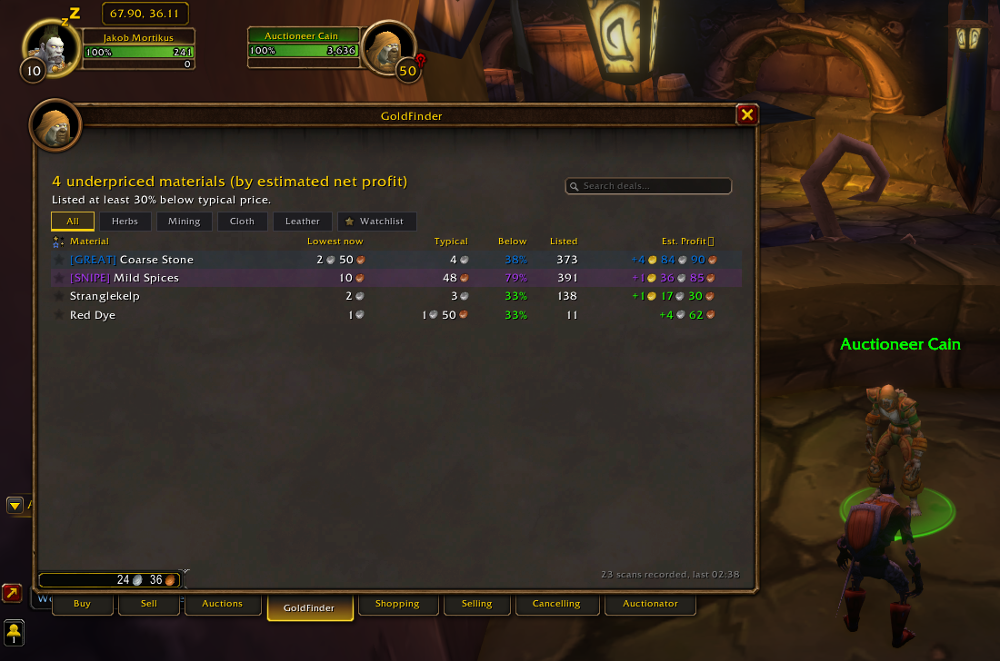
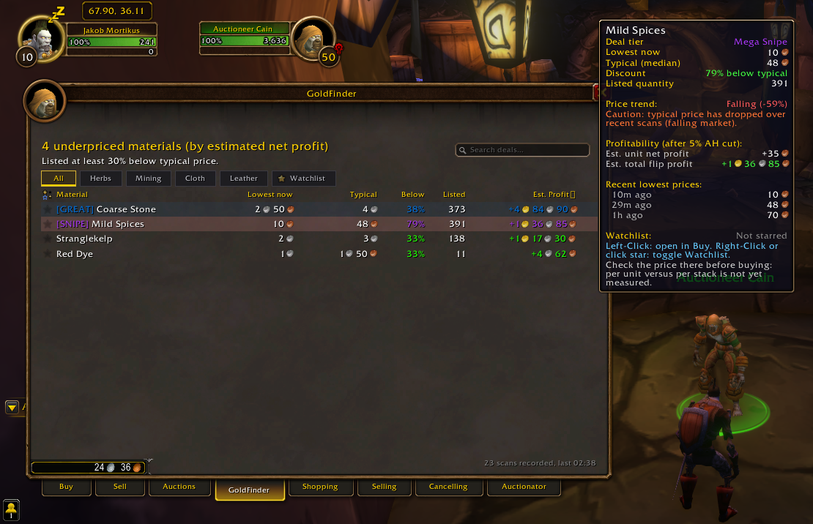
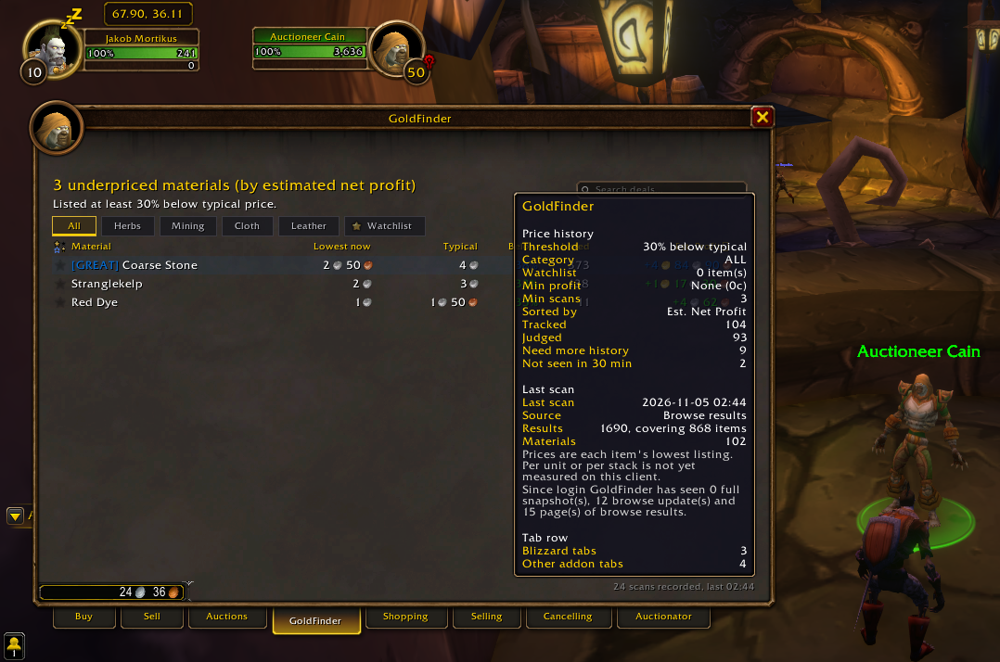
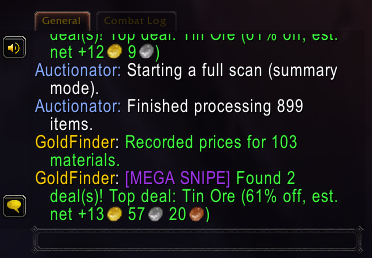

# GoldFinder — Smart Auction House Deal Hunter & Trading Suite

**GoldFinder** adds a dedicated, non-intrusive **GoldFinder** tab to the World of Warcraft Auction House that detects crafting materials, trade goods, and high-value items listed well below their typical market value. Built for goblins, crafters, and everyday players looking to maximize profit without wasting time.

---

## Why GoldFinder?

1. **Zero Scan Cooldown Waste:** GoldFinder never triggers auction searches on its own or steals your scan cooldown. It quietly hooks into scans and searches you already run (such as Auctionator's Full Scan or normal Buy tab browsing) and continuously builds a local pricing intelligence database.
2. **Peaceful Tab Coexistence:** Integrated via **LibAHTab**, GoldFinder cleanly docks alongside Blizzard's native tabs and other auction house addons without overlapping, fighting for frame focus, or tainting the UI.
3. **Evidence-Based Pricing:** Never falls for bait listings or manipulated 1-copper traps. GoldFinder evaluates market depth and historical median trajectories across multiple distinct sightings before judging an item as a deal.

---

## Key Features

### 💎 Smart Deal Radar & Valuation Models
- **Historical Median & Alternative Valuation Engines:** Evaluates baselines using Standard Median, 10% Trimmed Mean (filtering erratic outliers), or 7-Day Exponential Moving Average (EMA). Switch models anytime in Options.
- **True Net Profit Calculations:** Automatically deducts Blizzard's 5% auction house cut from flip profit calculations (`((Typical * 0.95) - LowestNow) * Quantity`).
- **Statistical Confidence Scores:** Categorizes markets into `[HIGH]`, `[MED]`, and `[THIN]` confidence tiers based on sample size and price variance to protect against low-liquidity traps.
- **Visual Tier Badges:** Instantly spot game-changing bargains with Epic Purple `[SNIPE]` highlights, Rare Blue `[GREAT]` value tags, and sound chimes.

### ⚡ Live Snipe Mode & Audio Alarms
- **Background Snipe Watcher:** Turn on Snipe Mode (`/gf snipe`) while browsing to instantly trigger audio alarms (`SOUNDKIT.RAID_WARNING`), screen banners, and Epic chat alerts when high-margin "Mega Snipes" hit the market.
- **Customizable Snipe Thresholds:** Configure minimum profit (e.g. 100g) or discount thresholds (e.g. 70%) via `/gf snipethreshold <amt>`.

### 🛒 One-Click Quick-Buy & Multi-Item Staging Cart
- **Direct Commodity Quick-Buy:** Shift-Left-Click any commodity deal row to buy instantly without switching to the Blizzard Buy tab.
- **Batch Staging Cart:** Alt-Left-Click deals to stage them into your `[ Cart (N) ]`. Review aggregate purchase costs, projected net flip profits, and execute batch purchases sequentially with automated spend cap protections.

### 🏷️ Blizzard Sell Tab Price Helper
- **Smart Selling Popout Card:** When dragging an item into Blizzard's Sell tab (`ItemSellFrame` or `CommoditiesSellFrame`), GoldFinder docks a neat market evaluation card.
- **Instant Price Autofill:** Displays historical median price, lowest current AH buyout, and market trajectory (Rising, Steady, Falling) with one-click quick-fill buttons: `[-1c Cut]`, `[Match]`, and `[Typical]`.

### 🔨 Crafting Arbitrage & Undercut Detection
- **Reagent Crafting Arbitrage:** Detects profitable crafting conversions (Smelting ores, Tailoring cloth bolts, Alchemy transmutes) where crafted output value exceeds total material input costs.
- **Vendor Reagent Integration:** Injects fixed NPC vendor costs (Flux, Coal, Thread, Vials) to avoid overpaying on the AH.
- **Active Undercut Monitor:** Cross-checks your active auctions (`C_AuctionHouse.GetOwnedAuctions()`) against current lowest browse prices on the `[ Undercuts ]` tab with 1-click cancel.

### 📬 Mailbox Collector & Goblin P&L Accounting Ledger
- **One-Click Deal Collector:** Adds a native `[ Collect Deals (N) ]` button to the mailbox to safely retrieve won items and record acquisition costs.
- **Realized Profit & Loss (P&L) Ledger:** Comprehensive financial dashboard (`/gf ledger` or `/gf pnl`) displaying Lifetime Net Profit, Average Flip ROI %, Total Flips, Top 3 Flips, and a searchable transaction log with hover breakdowns and CSV spreadsheet export.
- **Expired Auction Relist Advisor:** Classifies returned mail into actionable guidance (`[RELIST]`, `[HOLD - BELOW COST]`, `[WAIT - UNDERCUT WAVE]`).

### ⚙️ HUD Edit Mode-Style Profiles & Maintenance
- **Character-Specific & Account-Wide Profiles:** Switch between global settings and character-specific profiles with one click, mirroring WoW's native HUD Edit Mode architecture.
- **Base64 Profile Sharing:** Export and import full configurations, custom material categories, and watchlists via copy-pasteable strings (`/gf profile export|import`).
- **Automated Database Vacuum:** Built-in compaction engine prunes stale sightings (>30 days) and caps historical arrays every 7 days, keeping SavedVariables storage featherweight (<2MB).
- **Multi-Account DB Merger:** Ingest scan dumps across accounts (`/gf merge`) without losing local history.
- **Dedicated Chat Tab:** Route all notifications, deals, and snipes into a dedicated "GoldFinder" chat tab (`/gf chat tab`).

---

## In-Game Screenshots

| Main Auction House Tab & Sub-Tabs | Item Valuation & Trend Tooltip |
|:---:|:---:|
|  |  |
| *Category sub-tabs (Herbs, Mining, Cloth, Leather, Crafts, Undercuts, Watchlist), search bar, and visual tier badges* | *Deal tier (`[SNIPE]`, `[GREAT]`), 5% AH cut profit breakdown, and price trends* |

| Market Statistics & Scan Health | Scan Complete Chat Alerts |
|:---:|:---:|
|  |  |
| *Scan history, evaluated items count, and threshold stats* | *Instant chat notification when high-margin deals and snipes are detected* |

| Native AddOn List Categorization |
|:---:|
|  |
| *Cleanly organized under Blizzard's native `▼ Auctions` category alongside Auctionator* |

---

## Supported Game Clients

GoldFinder features unified multi-client support:

- **WoW: Forever** (Interface `16001`) — Verified on live client build 70707.
- **Classic Era & Season of Discovery** (Interface `11506`–`11509`, `20506`).
- **Retail / The War Within / Midnight** (Interface `110007`–`110200`, `120100`).
- **Mists of Pandaria Classic** (Interface `50400`–`50504`).

---

## Supported Languages

Full native translation and localized category filtering across 8 languages:
- **English** (`enUS` / `enGB`)
- **German** (`deDE`)
- **French** (`frFR`)
- **Spanish** (`esES` / `esMX`)
- **Simplified Chinese** (`zhCN`)
- **Traditional Chinese** (`zhTW`)
- **Korean** (`koKR`)
- **Russian** (`ruRU`)

---

## Quick Slash Command Reference

| Command | Action |
| :--- | :--- |
| `/gf` or `/goldfinder` | Opens the graphical Options & Settings window |
| `/gf tour` | Starts the interactive 6-step feature onboarding walkthrough |
| `/gf ledger` or `/gf pnl` | Opens the Realized Profit & Loss Goblin Ledger |
| `/gf cart` | Opens the Multi-Item Quick-Buy Staging Cart |
| `/gf snipe [on\|off]` | Toggles live background Snipe Mode |
| `/gf info` or `/gf about` | Opens the Journalator-style project info and diagnostics dashboard |
| `/gf chat tab` | Toggles routing messages to a dedicated "GoldFinder" chat tab |
| `/gf profile [export\|import]` | Opens the Base64 profile sharing dialog |
| `/gf vacuum [days]` | Runs manual database compaction and pruning |
| `/gf bench` / `/gf memory` | Runs real-time GC benchmarks and memory diagnostics |

---

## Credits & License

- **Author:** justadakaje
- **License:** MIT License
- **Vendored Libraries:** Includes [LibAHTab](https://github.com/TheMouseNest/LibAHTab) (MIT), LibStub, LibDataBroker-1.1, and LibDBIcon-1.0.
- **Independence:** GoldFinder is **not** based on Auctionator. None of Auctionator's code is used or was read. The two only share the auction house window through LibAHTab.
