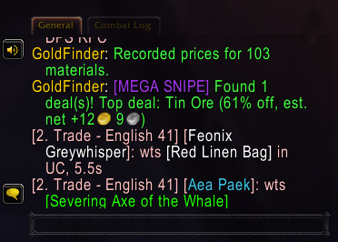

# GoldFinder

Finds crafting materials listed well below their normal price on the WoW:
Forever auction house. It adds one **GoldFinder** tab to the auction house
window, beside Blizzard's tabs and any other addon's.

GoldFinder never searches the auction house itself. It records the results
of scans and searches you already run (Auctionator's Full Scan, the Buy tab,
anything) and builds a price history from them. One scan feeds every addon,
and GoldFinder never uses up the auction house's scan cooldown.

## Screenshots & In-Game Previews

| Main Auction House Tab & Sub-Tabs | Item Valuation & Trend Tooltip |
|:---:|:---:|
|  |  |
| *Category sub-tabs (Herbs, Mining, Cloth, Leather, Watchlist), search bar, and visual tier badges* | *Deal tier (`[SNIPE]`, `[GREAT]`), 5% AH cut profit breakdown, and price trends* |

| Market Statistics & Scan Health | Scan Complete Chat Alerts |
|:---:|:---:|
|  |  |
| *Scan history, evaluated items count, and threshold stats* | *Instant chat notification when high-margin deals are detected* |

| Native AddOn List Categorization |
|:---:|
|  |
| *Cleanly organized under Blizzard's native `▼ Auctions` category alongside Auctionator* |

## What counts as a deal

For each material (trade goods and reagents), GoldFinder keeps up to 30 recorded
prices: the lowest listing seen in each scan.

- **Typical price** is the **median** of that item's *earlier* prices. The
  current price is left out, so a sudden cheap listing cannot drag its own
  baseline down. Median rather than average, so one listing at 1 copper or
  999 gold barely moves it.
- **A deal** is a current lowest price at least **30% below** typical.
- **Evidence first:** an item needs **3 earlier prices** before it is judged.
  Two sightings within 10 minutes count as one, so in practice that means
  scans on at least 4 separate occasions.
- **Freshness:** an item not seen in the last 30 minutes is not judged. It has
  probably sold.

Anything that cannot be judged is explained on the tab in a sentence, never
shown as an empty list or a zero.

## Sharing the tab row

The tab is added through [LibAHTab](https://github.com/TheMouseNest/LibAHTab)
(MIT). Every addon that uses the library shares one row of tabs, so they line
up side by side instead of drawing over each other. GoldFinder also:

- adds its tab once, however many times the auction house is opened;
- refuses to add a tab if another addon already uses its ID;
- detects an addon that adds a tab *without* the library, where tabs may
  overlap, and says so on the tab and in chat.

## Status

Tested on WoW: Forever 1.60.1, **build 70009**.

**Run and confirmed working:**

- The GoldFinder tab renders fifth, after Auctionator's four; selection switches
  cleanly; reopening the auction house does not duplicate it
- Prices are recorded from Auctionator's Full Scan: one scan recorded 249
  materials across 249 items
- The panel: centred "Building price history" empty state, a footer clear of
  the money display, and a details tooltip on hover
- **The deal table, on real data**: after four scans on separate occasions it
  listed 21 underpriced materials, deepest discount first, with names, prices
  and quantities
- **Deal to purchase**: clicking a deal opens it in Blizzard's Buy tab (tab
  highlighted, Blizzard's title), and a purchase made there goes through --
  one Raptor Egg bought, no action blocked
- **Prices are per unit for commodities**: Raptor Egg's "lowest now" (2s)
  matched the Buy view's Unit Price (2s 0c)

**Measured along the way:**

- Auctionator's "Full Scan (summary mode)" arrives as browse results (1 update
  and 9 pages), not a full snapshot. GoldFinder records both kinds.
- Browse results are per item *variant* (item + level + suffix): one Full Scan
  gave 4460 results covering 2054 distinct items. Auctionator reported 2059
  items for the same scan; the gap of 5 is unexplained.

**Written and NOT yet seen working:**

- **How reliable "typical" is on a thin market.** Current prices are right
  for commodities (see above), but typical is the median of as few as 3 earlier
  scans, and some first results look implausible -- Wool Cloth at 30c against
  a typical 2s 90c. The likelier cause is a small, volatile beta economy
  rather than mixed units, but that is not yet shown. **Check a deal in the
  Buy view before buying it**; a click takes you there.
- **Non-commodity materials**: whether their browse price is per unit or per
  stack is not measured.
- **The full-snapshot path** (`REPLICATE_ITEM_LIST_UPDATE`). No scanner used by
  the author triggers it. Until the snapshot's index numbering is measured, it
  reads every listing but one, to avoid an out-of-range call.

## Planned Enhancements & Feature Backlog

Active feature requests are tracked on GitHub:
- **Net Profit & Flip Value Display:** Calculating potential gold gains after deducting the 5% AH cut ([#10](https://github.com/justadakaje/wow-addons/issues/10))
- **Configurable Deal Thresholds:** Custom discount % and history scan sensitivity ([#11](https://github.com/justadakaje/wow-addons/issues/11))
- **Category Filters & Watchlist:** Filtering by trade good subclass (Herbs, Ore, Cloth, etc.) and starred items ([#12](https://github.com/justadakaje/wow-addons/issues/12))
- **Deal Alert Notifications:** Audio chime and chat summary when scans find deals ([#13](https://github.com/justadakaje/wow-addons/issues/13))
- **Direct Commodity Quick-Buy:** Shift-Click instant purchase for fast-moving commodity deals ([#14](https://github.com/justadakaje/wow-addons/issues/14))
- **Price Trend Indicator:** Distinguish between genuine dips and crashing markets ([#15](https://github.com/justadakaje/wow-addons/issues/15))
- **Tooltip Price Integration:** Show GoldFinder typical and lowest seen prices on item tooltips in bags/vendors ([#16](https://github.com/justadakaje/wow-addons/issues/16))
- **Undercut Detection:** Check active player auctions against current lowest prices ([#17](https://github.com/justadakaje/wow-addons/issues/17))
- **Crafting Conversion Profitability:** Reagent cost vs. crafted item sell value (smelting, milling, etc.) ([#18](https://github.com/justadakaje/wow-addons/issues/18))
- **Data Hygiene & CSV Export:** Prune old records and export pricing data to spreadsheets ([#19](https://github.com/justadakaje/wow-addons/issues/19))

See [`docs/goldfinder-backlog.md`](../../docs/goldfinder-backlog.md) for full technical design details.

## Client support

Forever only (`## Interface: 16001`). Other clients are untested.

## Licence

MIT, like the rest of this repository.

GoldFinder is **not** based on Auctionator. Auctionator's licence is All Rights
Reserved; none of its code is used or was read. The two only share the
auction house window. LibAHTab is a separate MIT-licensed project, vendored
in `libs/` with its licence; see [`libs/README.md`](libs/README.md).
